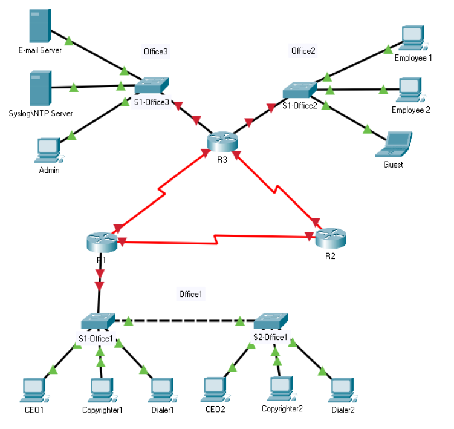

# Enterprise-WAN-Design

### Multi-Site Banking Network Simulation | Cisco Packet Tracer

This project demonstrates the design, configuration, and validation of an **enterprise-style Wide Area Network (WAN)** connecting multiple branch locations for a simulated banking environment.

The network was built in Cisco Packet Tracer and implements **LAN segmentation, inter-VLAN routing, dynamic routing, and layered security controls**, mirroring real-world enterprise network engineering and security practices.

## Network Architecture

- **WAN:** Three Cisco routers interconnected in a redundant triangle topology using OSPF Area 0.
- **Addressing:** `172.16.10.0/24` divided into eight `/27` subnets.
- **LAN:** Three Office 1 VLANs (Management, Marketing, Accounting) with 802.1Q trunking and router-on-a-stick inter-VLAN routing.
- **Security:** Extended ACLs, sticky MAC port security, SSHv2, and local device authentication.

## Network Topology

## Technical Documentation

| Document | Contents |
|---|---|
| [Network Design](docs/Network_Design_Document.md) | Topology, architecture, and design decisions |
| [IP Addressing Plan](docs/IP_Addressing_Plan.md) | Subnets, gateways, and host addressing |
| [VLANs & Trunking](docs/VLAN_and_Trunking.md) | VLAN assignments and 802.1Q configuration |
| [Routing & OSPF](docs/Routing_and_OSPF.md) | WAN routing and OSPF Area 0 |
| [Security Controls](docs/Security_Controls.md) | ACLs, port security, and device hardening |
| [Validation & Testing](docs/Validation_and_Testing.md) | Connectivity and security verification |

## Device Configurations

- [Router Configurations](configs/Router_Configuration.md)
- [Switch Configurations](configs/Switch_Configuration.md)
