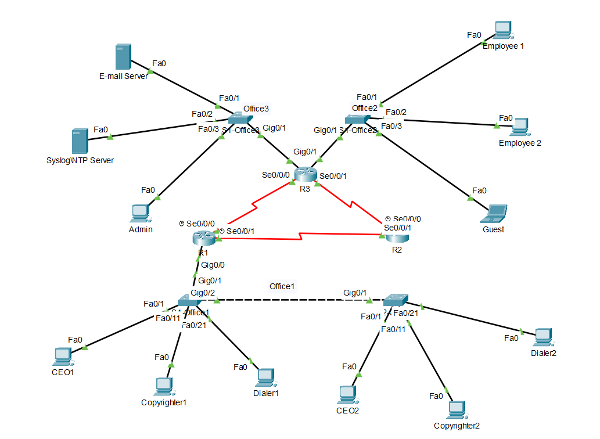

# Network Design Document
## Enterprise WAN Architecture & Segmentation

---

## 1. Overview

This project implements a secure and scalable Wide Area Network (WAN) connecting three branch offices for a simulated banking environment.

The objective was to design and configure a network that enables full inter-site communication while maintaining logical segmentation, controlled access, and hardened infrastructure following enterprise networking best practices.

The solution was developed in Cisco Packet Tracer and includes:

- Multi-site WAN routing
- VLAN segmentation
- Inter-VLAN routing
- Dynamic routing with OSPF
- Access control policies
- Switch port security
- Secure device management

---

## 2. Design Goals

The network was designed to achieve the following:

- Provide connectivity between all branch locations
- Segment traffic to reduce broadcast domains
- Improve security through VLAN isolation
- Enable scalable routing using a dynamic protocol
- Restrict unauthorized or guest access
- Harden network devices against misuse
- Follow real-world enterprise design standards

---

## 3. High-Level Architecture

### Topology Summary

- 3 Routers (branch gateways + WAN core)
- Layer 2 switches per site
- Multiple VLANs at Office 1
- Dedicated subnets per LAN
- Point-to-point WAN links between routers

### Logical Layout

---

## 4. LAN Design

Each office LAN is segmented to improve both performance and security.

### Office 1 – VLAN Segmentation

Office 1 supports multiple business functions and is divided into separate VLANs.

| VLAN | Purpose |
|-------|-----------|
| 10 | Executive / CEO |
| 20 | Copywriter Team |
| 30 | Dialer Team |

Benefits:

- Traffic isolation
- Reduced broadcast domains
- Security separation between departments
- Easier policy enforcement

---

### Office 2

Single subnet supporting:

- Employees
- Guest devices

Guest traffic is later restricted using ACLs.

---

### Office 3

Infrastructure-focused subnet supporting:

- Email server
- Syslog/NTP server
- Administrative workstation

---

## 5. Inter-VLAN Routing

### Method: Router-on-a-Stick

Inter-VLAN communication at Office 1 is handled by:

- 802.1Q trunk between switch and router
- Router subinterfaces for each VLAN
- Dedicated gateway per VLAN

### Rationale

Router-on-a-Stick was selected because:

- Cost-effective (single router)
- Simple to configure
- Suitable for small-to-medium branch environments
- Common in enterprise branch deployments

---

## 6. WAN Design

### Router Interconnections

Routers are connected using point-to-point serial links.

### Routing Protocol: OSPF

OSPF was implemented to:

- Automatically advertise routes
- Reduce manual configuration
- Improve scalability
- Provide fast convergence during failures
- Simulate enterprise dynamic routing behavior

### Benefits over Static Routing

- Easier maintenance
- Automatic route updates
- Better fault tolerance

---

## 7. Security Architecture

Security controls were layered throughout the network to protect systems and limit lateral movement.

### VLAN Segmentation

- Logical separation of departments
- Reduced attack surface

### Access Control Lists (ACLs)

- Restrict guest network access
- Prevent unauthorized communication with sensitive resources
- Enforce least-privilege traffic policies

### Port Security

- Sticky MAC learning
- Prevent rogue devices
- Limit unauthorized physical access

### Device Hardening

- SSHv2 only (no Telnet)
- Encrypted passwords
- Console authentication
- Login banners
- Secure remote management

---

## 8. Addressing Strategy

Each LAN and WAN link was assigned a dedicated subnet to:

- Simplify troubleshooting
- Improve isolation
- Support scalability
- Maintain consistent addressing

Detailed subnet information is documented separately in:

IP_Addressing_Plan.md

---

## 9. Validation & Testing

Connectivity and security were validated using:

- ping and traceroute
- Routing table verification
- OSPF neighbor checks
- VLAN segmentation tests
- ACL enforcement tests
- Port security verification

Results confirmed:

- Full WAN connectivity
- Correct segmentation
- Successful policy enforcement
- Secure device access

---

## 10. Lessons Learned

Key takeaways from the implementation:

- Proper subnet planning simplifies routing and troubleshooting
- VLAN segmentation significantly improves security posture
- Dynamic routing scales better than static routes
- Layered security controls reduce risk
- Clear documentation improves maintainability

---

## 11. Skills Demonstrated

This project demonstrates hands-on experience with:

- Enterprise network design
- Subnetting and addressing
- VLAN implementation
- Inter-VLAN routing
- OSPF configuration
- ACL design
- Port security
- Device hardening
- Troubleshooting and validation
- Technical documentation

---

## 12. Tools Used

- Cisco Packet Tracer
- Cisco IOS CLI
  

