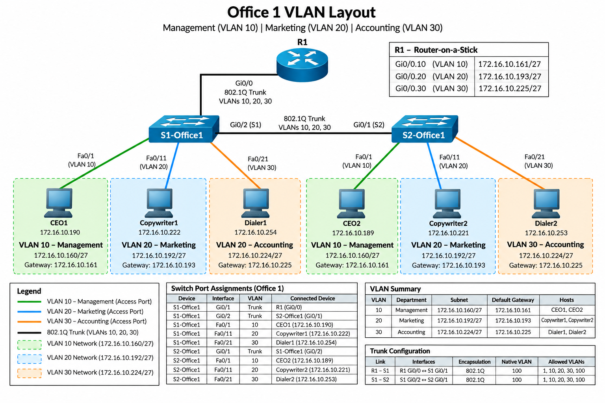

# VLANs & Trunking

## 1. VLAN Design

Office 1 uses three VLANs across two Cisco switches to separate departmental broadcast domains. Each VLAN has a dedicated IPv4 subnet and default gateway.

| VLAN | Department | Subnet | Default Gateway |
|---|---|---|---|
| 10 | Management | `172.16.10.160/27` | `172.16.10.161` |
| 20 | Marketing | `172.16.10.192/27` | `172.16.10.193` |
| 30 | Accounting | `172.16.10.224/27` | `172.16.10.225` |

VLANs 10, 20, and 30 are configured on both S1-Office1 and S2-Office1.

### Office 1 VLAN Layout

*Figure: Logical VLAN segmentation across two switches, with 802.1Q trunk connections and inter-VLAN routing through R1.*

## 2. Access Port Assignments

Workstation interfaces are configured as access ports assigned to their respective departmental VLANs.

| Switch | Interface | Connected Device | VLAN |
|---|---|---|---|
| S1-Office1 | Fa0/1 | CEO1 | 10 |
| S1-Office1 | Fa0/11 | Copywriter1 | 20 |
| S1-Office1 | Fa0/21 | Dialer1 | 30 |
| S2-Office1 | Fa0/1 | CEO2 | 10 |
| S2-Office1 | Fa0/11 | Copywriter2 | 20 |
| S2-Office1 | Fa0/21 | Dialer2 | 30 |

## 3. Trunk Connections

IEEE 802.1Q trunking enables multiple VLANs to traverse shared physical links between switches and the router.

| Device | Interface | Connected Device | Connection |
|---|---|---|---|
| S1-Office1 | Gi0/1 | R1 Gi0/0 | Router-facing trunk |
| S1-Office1 | Gi0/2 | S2-Office1 Gi0/1 | Inter-switch trunk |
| S2-Office1 | Gi0/1 | S1-Office1 Gi0/2 | Inter-switch trunk |

The inter-switch trunks carry traffic for VLANs 10, 20, and 30, with VLAN 100 configured as the native VLAN.

## 4. Inter-VLAN Routing

R1 implements a router-on-a-stick configuration using IEEE 802.1Q subinterfaces on GigabitEthernet0/0.

| Router Subinterface | VLAN | Default Gateway |
|---|---|---|
| Gi0/0.10 | 10 | `172.16.10.161` |
| Gi0/0.20 | 20 | `172.16.10.193` |
| Gi0/0.30 | 30 | `172.16.10.225` |

Each subinterface provides Layer 3 connectivity for its associated VLAN.

Traffic between VLANs is forwarded through R1, while traffic within the same VLAN remains in its respective Layer 2 broadcast domain.
